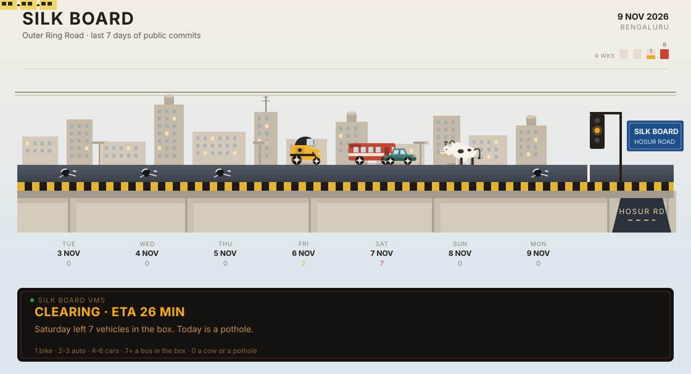

# Uday Kiran Reddy N

I code and decode stuff. Full-stack developer in Bangalore — about three years of building software, a year and a half of that in industry — looking for full-stack roles where AI is part of the work.

[GitHub](https://github.com/UdaykiranReddy-1) · [LinkedIn](https://www.linkedin.com/in/uday-kiran-reddy-n-7845b0280/) · [uday410ry@gmail.com](mailto:uday410ry@gmail.com)

**Stack, from the public repos.** TypeScript, JavaScript, Python, and Java, with some Go and C. React and Next.js up front. Node, Express, and Spring Boot behind them. Postgres, Prisma, and MongoDB when a project needs a database.

## Silk Board

The flyover is the public contribution graph for the last seven days. A commit sends a vehicle onto Outer Ring Road — a bike, an auto, cars, or a bus once the day is actually busy. An empty day leaves a pothole. An empty Sunday leaves a cow. The sign at the bottom is regenerated every morning from the GitHub contribution calendar.

<!-- silk-board:start -->
<picture>
  <source media="(prefers-color-scheme: dark)" srcset="assets/silk-board-dark.svg">
  
</picture>
<!-- silk-board:end -->

## Ask this README

Open an issue with the **Ask Uday's README** template and ask about the work, the stack, or the projects. A workflow answers in a comment from public repos only: names, descriptions, languages, READMEs, and recent activity. If that data does not cover the question, the answer is "I don't know".

It ignores issues that are not the template and do not carry the `ask-readme` label. Questions longer than 500 characters are declined. Five answers a day, then the junction is closed until tomorrow. The question is treated as data, not as instructions.

<!-- qa:start -->
No questions yet. Be the first one through the signal.

<!-- qa:end -->

## Selected work

**[Serenity.ai](https://github.com/UdaykiranReddy-1/Serenity.ai)** — A healthcare web app: an AI chatbot, a DASS-21 scoring flow, and a view for doctors. Next.js, MongoDB, and Botpress. [Demo](https://serenityai-42c1.vercel.app/)

**[rbac-project](https://github.com/UdaykiranReddy-1/rbac-project)** — Multi-tenant role-based access control for a SaaS backend. TypeScript, Express, PostgreSQL, Prisma, and JWT.

**[WanderLust](https://github.com/UdaykiranReddy-1/WanderLust)** — Tour bookings on the MERN stack, with a separate client and server.

**[the-world](https://github.com/UdaykiranReddy-1/the-world)** — A React country browser on the REST Countries API, with filters and a Leaflet map. [Demo](https://the-world-rho.vercel.app)

**[POS-Frontend](https://github.com/UdaykiranReddy-1/POS-Frontend)** — Blockzy, a JavaScript simulation of Ethereum proof-of-stake: blocks, staking, and wallets. [Demo](https://pos-isfcr.vercel.app)

**[learnsz](https://github.com/UdaykiranReddy-1/learnsz)** — LearnLock, a Solana learning passport. Soul-bound tokens for finishing micro-lessons, and a small marketplace for creators.

Also on the account: [sql-executor](https://github.com/UdaykiranReddy-1/sql-executor) (a Spring Boot service that runs a query and returns rows), [Http-Server-Go](https://github.com/UdaykiranReddy-1/Http-Server-Go) (an HTTP server built up in stages), and [PyScripts](https://github.com/UdaykiranReddy-1/PyScripts) (small automation scripts).

## Now

Side projects. Learning system design and cloud. Happy to collaborate on full-stack work that actually uses AI.

---

Silk Board is redrawn by a scheduled Action. Questions are answered by another. Both commit their results back here.
